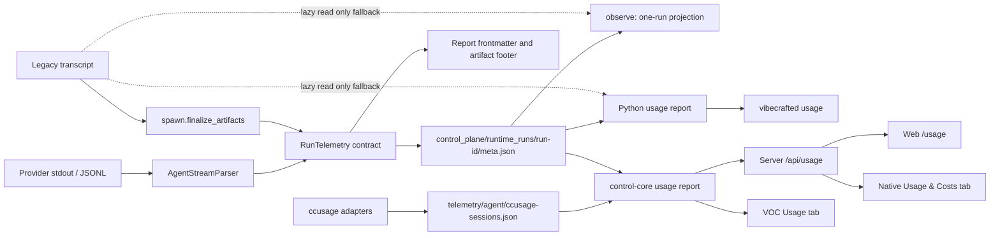

# Vibecrafted telemetry and usage-reporting surface

Snapshot: `cut/grok-work-261102-133013-07759` — one usage report, read by the web dashboard and the VOC Usage tab.

Loctree coverage: 1459 of 1459 indexed files. Ten `loct` calls were used. The
first failed on the sandboxed global cache; the remaining calls used a fresh,
repo-local snapshot. Source inspection below was bounded by the resulting
files and symbols.

## Baseline truth

Vibecrafted already has a coherent, local per-run telemetry contract. It
captures provider usage, cost, model, provider session identity and failure
attribution; writes them into run metadata and report frontmatter; and can
aggregate them through a Python CLI report.

The web `/usage` dashboard and the VOC Usage tab both read the control-core
usage report. A cost whose source starts with `estimated` is prefixed with
`~` and does not read as a provider bill. An unknown cost stays `unknown`.
The public shell still routes `vibecrafted usage` to the Python report.

`telemetry smoke` is a separate marbles runtime smoke test. It neither reports
product usage nor feeds a dashboard.

## Implemented cut

- `usage_reporting.py` is the reusable Python projection behind the CLI, and
  both public launcher copies route `vibecrafted usage` to it.
- `control-core` owns a read-only `UsageReport`; the server exposes it at
  `/api/usage` and renders the human dashboard at `/usage`.
- VOC has a fifth `Usage` tab, backed by the same control-core report rather
  than a second parser.
- VibecraftedApp registers `Usage & Costs` as a runtime-scoped native
  destination at `/usage`.
- Local sessions for claude, codex, grok, kimi, copilot and agy are measured
  in process by the `ccusage` adapters and projected by `usage_local`. See
  [ccusage collection](#ccusage-collection).
- The web dashboard and the VOC Usage tab label an estimate with `~`. Totals
  still sum the numeric amounts. The VOC summary names the estimated part of
  the USD total only when that part is not zero.

The live dashboard continues to read canonical Vibecrafted run metadata plus
the local projection. Neither surface rewrites run metadata.

## ccusage collection

Measured sessions for claude, codex, grok, kimi, copilot and agy come from the
in-process adapters in `vibecrafted-server/control-core/src/usage_ccusage.rs`.
Each adapter reads that provider's host session store. The projection is
`<telemetry>/<agent>/ccusage-sessions.json`
(`vibecrafted.ccusage-sessions.v1`). When that file has sessions it is the
only local source for the provider.

`vibecrafted-server/control-core/src/usage_local.rs` turns those rows into the
same `vibecrafted.usage-report.v1` that `/api/usage`, the web dashboard and
the VOC Usage tab read. A local session already carried by a Vibecrafted run
is not counted again.

Python still runs on the same collection flight. It writes
`telemetry/<agent>/quota.json` and still scans junie and omp. The same flight
reads claude, codex, grok, kimi, copilot and agy in process, and that
measurement replaces Python's session row for those providers when
`<agent>/ccusage-sessions.json` has sessions. `scan-cache.json` (written by
`fleet_engine`, and by the kimi harvest for kimi) and
`archive/<agent>.jsonl` are the fallback when that projection is absent or
empty.

A provider with no store is not reported as zero. agy, when it has only
estimated transcripts and no token ledger, is `unavailable`. cursor, whose
usage lives in the Cursor cloud, is `unavailable`. Any other provider with
nothing collected yet stays `absent`.

A cost is labelled from `cost.source`. A source that starts with `estimated`
is an estimate: the web cell is prefixed with `~` and titled
`Estimated from list prices, not a provider bill`; the VOC row uses the same
`~` (`~$0.6496 USD`, or `~$0.6496` on the home receipt). A reported USD cost
is `$11.0899 USD` on the VOC row and the amount plus unit on the web. Another
unit stays its own unit (`7.00 credits`). An unknown amount stays `unknown`
and keeps its reason. Totals and charts still sum the numeric amounts. The
web total is not given a separate estimate label. The VOC USD line adds how
much of that total is estimated only when the estimated part is not zero, so
a fully reported total looks the same as before.

The report differs from `npx ccusage` in the three places named in
[pricing/SOURCE.md](../vibecrafted-server/control-core/pricing/SOURCE.md):

- Kimi `k3` is not resolved fuzzily to `kimi-k3-fast` (upstream applies 1.5 times Moonshot's price).
- Copilot shutdown aggregates test a whole session's sum against the context
  tier, not one request.
- A session whose model has no list price is unknown, not zero.

## Ownership map

| Layer                 | Owner                                          | Responsibility                                                                                              | Runtime status                     |
| --------------------- | ---------------------------------------------- | ----------------------------------------------------------------------------------------------------------- | ---------------------------------- |
| Provider parsing      | `vibecrafted_core/agent_stream.py`             | Normalizes provider-specific session, model, token and cost events                                          | Wired into live stream supervision |
| Neutral contract      | `vibecrafted_core/telemetry.py`                | `UsageRecord`, `CostRecord`, `FailureAttribution`, `RunTelemetry`; preserves unknown versus measured zero   | Canonical per-run schema           |
| Async close writer    | `vibecrafted_core/supervisor_async.py`         | Builds telemetry from provider-stream counters; writes meta and report frontmatter                          | Live path                          |
| Launcher close writer | `vibecrafted_core/spawn.py`                    | Derives telemetry from transcript/report, relocates artifacts, writes meta/frontmatter/footer               | Live compatibility path            |
| Durable run truth     | `vibecrafted_core/control_plane.py`            | Owns `<VIBECRAFTED_HOME>/control_plane/runtime_runs/<run-id>/meta.json`; resolves legacy artifacts second   | Canonical read-follows-write path  |
| One-run reporting     | `vibecrafted_core/cli.py::_observed_telemetry` | `observe` projects recorded telemetry or lazily derives old runs from transcripts without rewriting them    | Public lifecycle path              |
| Aggregate reporting   | `vibecrafted_core/usage_reporting.py`          | Reusable builder with time/run/provider/agent/model filtering; emits `vibecrafted.usage-report.v1`          | Used by CLI and public deck        |
| Public shell deck     | `scripts/vibecrafted` and packaged deck copy   | Routes both `usage` and the separate `telemetry smoke` command                                              | Reachable                          |
| Server API and web    | `control-core::usage`, `web` `/usage`          | Read-only report. A `ccusage` source prints its counted local rows. An estimate is prefixed `~`             | Implemented                        |
| VOC                   | `tui-agent::usage`                             | Same report. `display_cost` prefixes an estimate. The USD line names the estimated part when it is not zero | Implemented                        |
| Native app            | `ToolDestinations.swift`                       | Runtime-scoped `Usage & Costs` destination                                                                  | Implemented                        |
| Local sessions        | `control-core::usage_ccusage`, `usage_local`   | In-process measurement and the report projection described under ccusage collection                         | Implemented                        |
| Quota, junie, omp     | Python collection flight                       | Writes `quota.json` and still scans junie and omp                                                           | Python                             |

## Data contract

`vibecrafted.usage.v1` records:

- input, cached-input, cache-write, output and total token counts;
- event count, unit and evidence source;
- an explicit `Unknown` object with a reason when the provider supplied no
  evidence. Zero is retained only when a provider actually reported zero.

Cost is one of:

- provider-reported monetary cost;
- an estimate tied to a named, dated price table;
- an unknown value with a reason;
- a provider-native unit such as credits, kept separate from USD.

Dashboards label that cost the same way. A source that starts with
`estimated` renders with a leading `~` and, on the web row, the title
`Estimated from list prices, not a provider bill`. A known non-estimate is
the amount and its unit. An unknown amount stays `unknown` and keeps its
reason. Totals and charts keep summing the numeric amounts.

The enclosing run telemetry also carries failure classification and evidence,
plus provider session identity guarded against accidentally copying a parent
session ID.

## Persistence and aggregation

The primary record is each run's `meta.json`. Telemetry is also projected into
Markdown frontmatter and artifact footers. There is no telemetry database,
rollup file, index or event warehouse.

`usage --since` walks every
`control_plane/runtime_runs/*/meta.json` at query time. Explicit `--run-id`
uses the shared resolver, which checks canonical runtime runs first and legacy
artifacts second. Old records without structured usage are parsed lazily from
their transcript and labelled `transcript(lazy)`; observation does not mutate
them.

The aggregate schema reports:

- per-run agent, model, status, exit code, usage, cost and failure;
- known token sum plus count of runs with unknown tokens;
- cost sums grouped by currency or provider unit;
- count of runs with unknown cost.

## Verification surface

`vibecrafted-core/tests/test_usage_telemetry.py` is the main contract suite
(611 LOC). It covers measured zero versus unknown, provider-reported versus
estimated cost, unit separation, session-parent rejection, both close writers,
lazy legacy derivation, deterministic JSON, time filtering and human table
output. Parser-specific coverage also lives in `test_agent_stream.py`; close
integration reaches `test_supervisor.py` and `test_supervisor_async.py`.

The delivered contract tests cover Python reporting, public-deck parity,
control-core aggregation, the ccusage collection, HTTP projection, web
render, VOC rendering, and native destination resolution.

## Dashboard seam and risks

The smallest coherent dashboard seam is the existing
`vibecrafted.usage-report.v1` projection. It should be lifted behind one
control-plane read API and consumed by web/native surfaces, rather than
duplicating transcript parsing or cost arithmetic in UI code.

Remaining scale and product decisions:

1. Add pagination or a bounded index; the current time-window report scans all
   run directories and opens matching metadata/transcripts.
2. Define the remote-dashboard privacy projection before exposing it beyond
   the local server. Raw failure messages, evidence
   paths and provider session IDs belong in drill-down only, not aggregate
   cards or any future remote export.
3. Keep the price table provenance visible and refreshable; estimates are
   dated fallback evidence, not billing truth. The dashboards prefix an
   estimate. The web total stays the summed amount. The VOC USD line names
   the estimated part only when that part is not zero.
4. Rename or clearly separate `telemetry smoke`, whose current name collides
   with usage telemetry while testing a different subsystem.

No network telemetry exporter, remote ingestion call, opt-in setting or
background usage upload was found in the mapped runtime flow.

## Ten-call receipt

1. Broad context pack: failed on inaccessible global cache.
2. Fresh task context in repo-local cache.
3. Full-repository telemetry/usage literal-regex inventory.
4. JSON slice of `telemetry.py`.
5. Human slice of `telemetry.py`.
6. JSON occurrences of `run_telemetry_from_meta` (schema-selection mismatch).
7. Compact occurrences of `run_telemetry_from_meta`.
8. Slice of `test_usage_telemetry.py`.
9. Compact occurrences of `build_run_telemetry`.
10. Exact flow inventory for builders, readers, writers and report schema.
