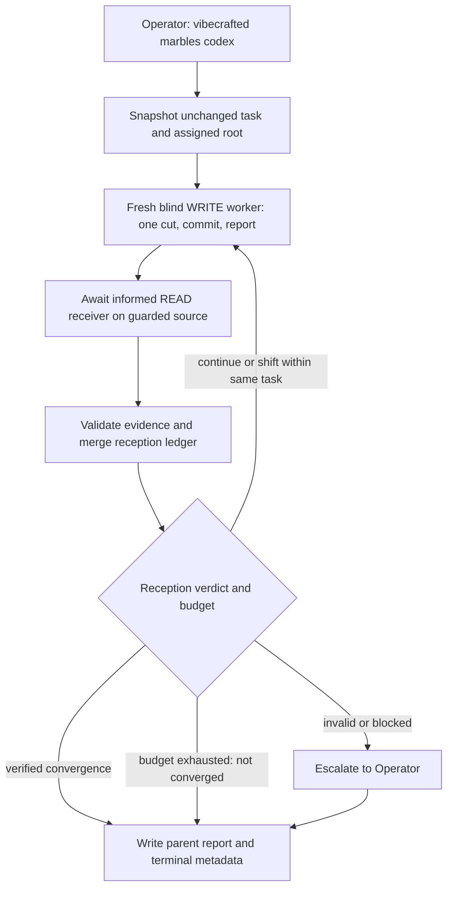

# `vc-marbles` Flow

## Flow

## Trasy

| Wejście                                                             | Argumenty                                                                   | Produkuje                                                              | Wyjście                    |
| ------------------------------------------------------------------- | --------------------------------------------------------------------------- | ---------------------------------------------------------------------- | -------------------------- |
| `vibecrafted marbles <agent>`                                       | dokładnie jeden z `--prompt`, `--file` lub `--depth`; opcjonalnie `--count` | raport ancestora plus raporty pętli, transkrypty i meta pod `marbles/` | `0` przy launchu           |
| `vc-marbles <agent>`                                                | tak samo                                                                    | tak samo                                                               | `0` przy launchu           |
| `vibecrafted marbles pause\|stop\|resume\|session\|inspect\|delete` | argumenty sterujące                                                         | akcje sterujące runtime'em marbles                                     | `0` przy udanym sterowaniu |

Po dispatchu od razu uzbrój `vibecrafted await <agent> --run-id <id>` po stronie
supervisora. JSON control plane'u, pliki raportów, transkrypty, pane'y i
zaplanowane wybudzenia są wyłącznie diagnostyczne — to nie są sygnały wybudzenia.
Hedge'owanie awaita doraźnymi pollerami/watcherami to naruszenie Class 3; napraw
`control_plane.await_run`, nie normalizuj hedge'a. Zobacz `docs/runtime/AGENT_OPS.md`.

Liveness na 3 sygnałach: verdict awaita, terminalne meta runu, martwy pid workera,
plus obecność obiecanego raportu. Dwa zgodne sygnały wystarczą, żeby działać, trzy —
żeby ogłosić done; każda niezgodność oznacza traktuj jako żywy i uzbrój await
ponownie. Znany skew: rc=0 przy żywym runie i meta zawieszone na `active`/`stalled`
po faktycznym zakończeniu.

### Krawędzie eskalacji

- Ten sam blocker utrzymuje się po wielu pętlach -> `vibecrafted partner <agent>`
- Pozostała luka jest szersza niż zbieżność -> `vibecrafted ownership <agent>`
- Operator chce auditu zamiast kolejnych pętli -> `vibecrafted followup <agent>`

### Artefakty sesji

- Obecny właściciel w core: `workflow_runtime.run_marbles`, nadzorowany przez `AsyncSupervisor`.
- Raport rodzica: `report` z potwierdzenia launchu; dzieci leżą obok w `<run_id>-children/`.
- Wyjścia WRITE: `marbles-L<N>.md`, transkrypt, prompt i metadane na tym samym przydzielonym korzeniu.
- Wyjścia READ: osobne artefakty `marbles-L<N>-reception`; `reception.json` trzyma przyjęte findingi, metryki, routing i końcowy werdykt. Stan odbiorcy nigdy nie jest wstrzykiwany do promptów WRITE.
- `--count` to maksimum, nie dowód zbieżności. Ukończony run może mieć `verdict: not_converged` po wyczerpaniu budżetu. Niepoprawna weryfikacja lub powtarzające się porażki dają `blocked`; tylko zweryfikowany pusty reception daje `converged`.
- Natywny resume działa wyłącznie przez zweryfikowane adaptery; pozostali providerzy dostają świeżego poinformowanego odbiorcę READ. Strażnik źródeł macOS chroni przydzielone pliki i współdzielone metadane Gita. Hosty bez tego strażnika na razie jawnie blokują reception.
