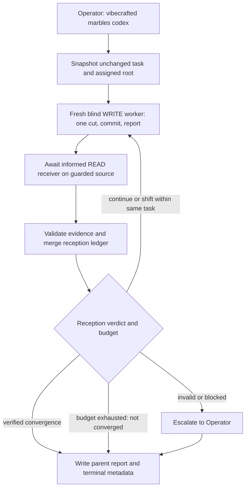

# `vc-marbles` Flow

## Flow

## Routes

| Entry                                                               | Args                                                                  | Produces                                                                  | Exit                   |
| ------------------------------------------------------------------- | --------------------------------------------------------------------- | ------------------------------------------------------------------------- | ---------------------- |
| `vibecrafted marbles <agent>`                                       | exactly one of `--prompt`, `--file`, or `--depth`; optional `--count` | ancestor report plus loop reports, transcripts, and meta under `marbles/` | `0` on launch          |
| `vc-marbles <agent>`                                                | same                                                                  | same                                                                      | `0` on launch          |
| `vibecrafted marbles pause\|stop\|resume\|session\|inspect\|delete` | control args                                                          | marbles runtime control actions                                           | `0` on control success |

After dispatch, arm `vibecrafted await <agent> --run-id <id>` immediately,
supervisor-side. Control-plane JSON, report files, transcripts, panes, and
scheduled wakeups are diagnostic only, not wake signals. Hedging await with
ad-hoc pollers/watchers is a Class 3 violation; fix `control_plane.await_run`,
do not normalize the hedge. See `docs/runtime/AGENT_OPS.md`.

3-signal liveness: await verdict, terminal run meta, worker pid dead, plus
promised report presence. Two agreeing signals are enough to act, three to
declare done; any disagreement means treat as live and re-arm await. Known skew:
rc=0-on-live and meta stuck `active`/`stalled` after real completion.

### Escalation edges

- Same blocker persists after repeated loops -> `vibecrafted partner <agent>`
- The remaining gap is broader than convergence -> `vibecrafted ownership <agent>`
- The operator wants an audit instead of more loops -> `vibecrafted followup <agent>`

### Session artifacts

- Current core owner: `workflow_runtime.run_marbles`, supervised by `AsyncSupervisor`.
- Parent report: the launch receipt's `report`; children live beside it in `<run_id>-children/`.
- WRITE outputs: `marbles-L<N>.md`, transcript, prompt and metadata on the same assigned root.
- READ outputs: separate `marbles-L<N>-reception` artifacts; `reception.json` holds accepted findings, metrics, routing and final verdict. Receiver state is never injected into WRITE prompts.
- `--count` is a maximum, not proof of convergence. A completed run can have `verdict: not_converged` after exhaustion. Invalid verification or repeated failures yield `blocked`; only verified empty reception yields `converged`.
- Native resume is used only through verified adapters; other providers use a fresh informed READ receiver. The macOS source guard protects assigned files and shared Git metadata. Hosts without this guard currently block reception explicitly.
